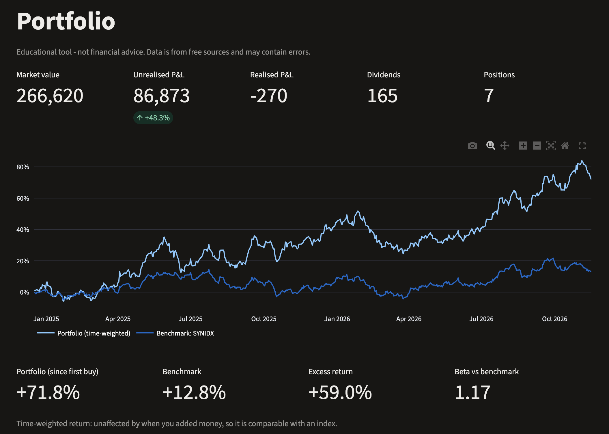
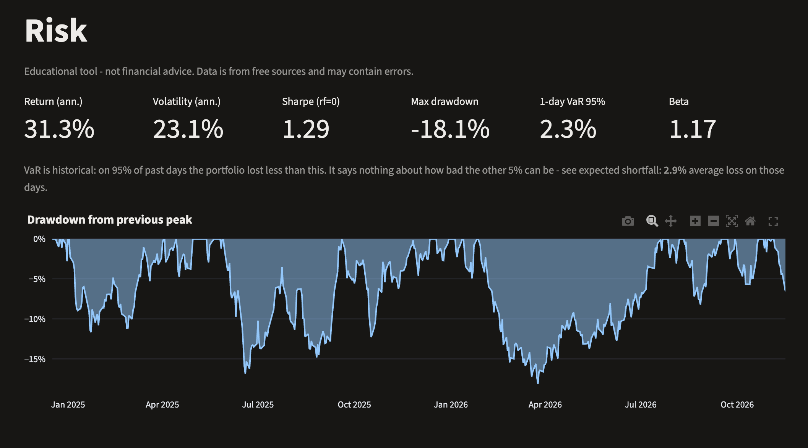
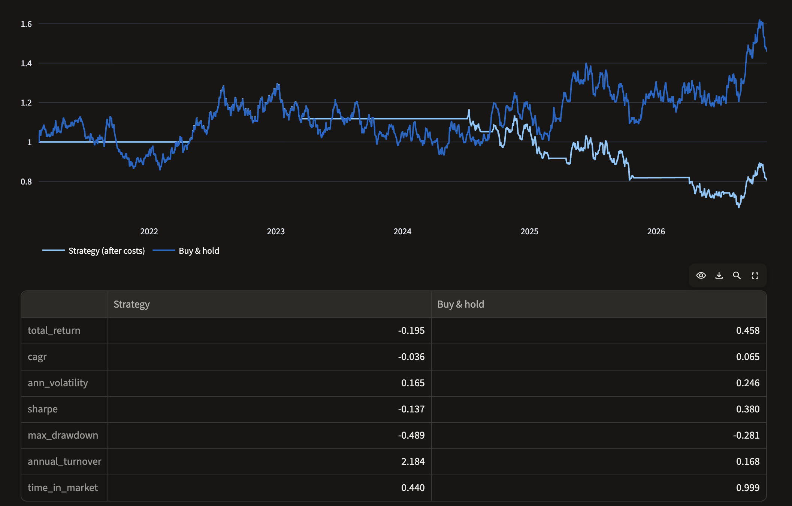

# StockLens Analytics

> **Educational tool - not financial advice.** Past performance does not predict future results. Data comes from free sources and may contain errors.

A Python analytics backend for ASX, US and Vietnamese equities: automated data pipeline, personal portfolio tracker, risk analytics, backtesting with transaction costs, and an honest walk-forward ML experiment - with a Streamlit dashboard and a weekly HTML report.

It is the numbers layer that sits behind **StockLens** (my document-reading app that extracts figures from company reports).

**Live demo:** _<add your Streamlit Community Cloud link here>_ (runs on synthetic sample data - no real holdings are published)





_Screenshots use generated sample data, not real prices or holdings._

## Headline result

Honest, carefully measured negative results (details and limits in [Results](#results)):

- **ML:** on 16 large US and ASX stocks, neither logistic regression nor a random forest beat the "always up" baseline at predicting next-month direction. A model was ahead on only 2 of 16 stocks (+0.4 and +1.2 points), none was significant after correction (adjusted p = 1.0), and on average the better model was 1.0 point worse than the baseline.
- **Backtests:** a 10/50-day moving-average crossover on AAPL scored a Sharpe ratio of 0.95 in-sample but 0.57 on unseen data (buy and hold: 0.94). Top-3 cross-sectional momentum earned 17.1% a year against 19.3% for holding all 16 stocks equally (Sharpe 0.79 vs 1.32), after 20 bps costs.

## Results

All results use daily Yahoo Finance prices (adjusted close) for 16 large US and ASX stocks from 2018 to 19 Nov 2026. The watchlist was picked today, so it has survivorship bias. Educational project, not financial advice.

### ML direction forecast: an honest negative result
Question: can a model predict whether a stock will be higher in about 21 trading days, better than a dumb baseline?

Method: walk-forward validation (about 23 folds, roughly 1,400 test days per stock) with a 21-day gap between training and test data. Logistic regression and a random forest are compared with an "always up" baseline, using a sign test on non-overlapping samples with a Bonferroni correction for 2 models and 16 stocks.

Result: a model beat the baseline on only 2 of 16 stocks (WES.AX +0.4 points, WOW.AX +1.2 points). Neither was significant (adjusted p = 1.0 for every stock), and on average the better model was 1.0 point worse than "always up". Conclusion: no evidence that price-only features predict one-month direction.

Limits: overlapping 21-day labels leave about 65 independent months per stock, so a small real edge could be missed. The stocks move together, so the 16 tests are not independent. Features use price history only.

### Moving-average crossover on AAPL
The best parameter pair picked on the first 60% of history (10/50 days) had an in-sample Sharpe ratio of 0.95. On the unseen last 40% (from April 2023) it scored 0.57, against 0.94 for buy and hold. The in-sample result was partly noise, which is why every backtest here is checked out-of-sample.

### Cross-sectional momentum
Each month-end, hold the top 3 of the 16 stocks by 126-day return (equal weight, 20 bps cost per trade), compared with holding all 16 equally:

| | Top-3 momentum | Equal-weight all 16 |
|---|---|---|
| Total return | +322% | +398% |
| Annual return (CAGR) | 17.1% | 19.3% |
| Volatility | 23.7% | 14.2% |
| Sharpe ratio | 0.79 | 1.32 |
| Max drawdown | -34.2% | -28.1% |
| Annual turnover | about 890% | about 11% |

Concentrating in three recent winners added risk and trading costs without adding return.

### Data quality
The pipeline checks every price series for gaps, outliers, suspected unadjusted splits, bad bars and stale data. It only flags problems and never changes the data. On the 18 series in the 19 Nov 2026 snapshot it raised 54 flags: 53 large one-day price moves ("outliers") and 1 bad bar (CBA.AX, 2024-11-15: close outside the day's high-low range, likely a source error). Spot checks of the outliers match known market events (the March 2020 crash, the April 2025 tariff-pause rally, NVIDIA earnings days), so they were kept.

## What it does

| Area | Features |
|---|---|
| Data | Daily prices, dividends and fundamentals for US/ASX (Yahoo Finance) and Vietnam (price files you export yourself; `vnstock` is currently not installable) into SQLite; incremental updates; data-quality checks (gaps, outliers, suspected unadjusted splits, stale data) |
| Portfolio | Transactions CSV -> holdings, average cost, realised / unrealised P&L, dividends, time-weighted return vs a benchmark |
| Analysis | SMA / EMA / RSI / MACD / volatility / Bollinger; valuation vs sector peers; quality-value-momentum watchlist screener |
| Risk | Volatility, max drawdown, Sharpe, beta, correlation matrix, historical VaR and expected shortfall, concentration warnings |
| Models | Vectorised backtester (next-day execution, costs), parameter sweep, in-sample vs out-of-sample test, cross-sectional momentum; walk-forward direction forecasting vs two baselines |
| Output | 4-page Streamlit dashboard, weekly self-contained HTML report |

## Quick start (demo data, no internet needed)

```bash
python -m venv .venv && source .venv/bin/activate
pip install -e ".[dev]"
python -m stocklens.ingest.sample          # builds data/sample.db + data/sample_transactions.csv (synthetic)
streamlit run app/Home.py                  # dashboard
python -m stocklens.reports.weekly         # reports_out/weekly_<date>.html
pytest                                     # test suite
```

## Using your real data (stays on your computer)

```bash
pip install -e ".[data]"                                   # adds yfinance
python -m stocklens.ingest.update                           # fills data/stocklens.db (git-ignored)
cp data/sample_transactions.csv data/private/transactions.csv   # then replace with YOUR trades (git-ignored)
streamlit run app/Home.py
```

Transactions CSV columns: `date, symbol, type, quantity, price, fees`, where `type` is `BUY`, `SELL` or `DIVIDEND` (for dividends: `quantity` = shares held, `price` = cash dividend per share).
`data/private/` and `data/stocklens.db` are in `.gitignore`: **never commit real holdings.**

Vietnamese stocks: put one CSV per ticker in `data/vn_csv/` (e.g. `FPT.csv`; needs a date and a close column), list your tickers in `config/private.toml` (git-ignored), then run `python -m stocklens.ingest.update --watchlist config/private.toml --no-fundamentals`. See `src/stocklens/ingest/csv_files.py` for accepted formats.

## Design decisions

- **Next-day execution + costs in every backtest.** A signal from today's close trades tomorrow; every position change pays `cost_bps`. `tests/test_models.py` proves a hindsight-perfect signal cannot profit from the same day's move.
- **Walk-forward validation with a purge gap.** Time series are never shuffled; training stops `horizon` days before each test block because labels look forward.
- **Baselines first.** The ML model must beat "always predict up" and "last month repeats". p-values use non-overlapping samples (overlapping monthly labels would overstate significance) and a 2-model correction.
- **Fetchers behind an interface.** Free data sources break; each is one small class that can be swapped.
- **Time-weighted returns** so the portfolio-vs-benchmark comparison is not distorted by when I add money.

## Limitations (read these)

- **Fundamentals are today's snapshot, not point-in-time**, so they are used for the screener only and never in backtests (that would be look-ahead bias).
- **Survivorship bias:** the watchlist is stocks that exist today; failed or delisted companies are absent, which flatters backtests.
- **One historical path.** Backtest parameters are fitted to it; the sweep and out-of-sample test show robustness but do not prove an edge.
- Average-cost accounting only; **stock splits and multi-currency are not modelled** in the portfolio tracker.
- Free data (Yahoo) is unofficial, can be wrong, and can change or disappear.
- The ML result is research, **not a trading signal**.

## Project layout

```
src/stocklens/   ingest/ portfolio/ analysis/ models/ reports/   (db.py, context.py)
app/             Streamlit dashboard (Home.py + pages/)
tests/           pytest suite (maths checked against hand calculations)
docs/            BUILD_GUIDE.md - stage-by-stage plan
.github/         CI tests + daily pipeline health check
```

## License

MIT - see `LICENSE`.
